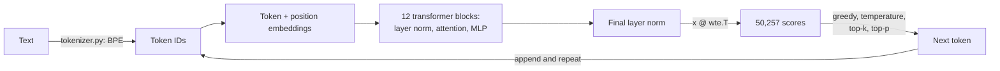

# GPT-2 from scratch in NumPy

OpenAI's GPT-2 (124M) running on my own code: a safetensors reader, a byte-level BPE
tokenizer, the transformer forward pass and sampling, using only **NumPy** and **regex**.
No PyTorch, no TensorFlow, no Hugging Face libraries.

I built this to understand what happens inside an LLM, one step at a time.

```
$ python gpt2.py
Alan Turing theorized that computers would one day become the most powerful machines
on the planet.

The computer is a machine that can perform complex calculations
```

## How it works



| Part | What it does |
|---|---|
| Weights | Reads OpenAI's `model.safetensors` directly: 8-byte header length, JSON header, then raw float32 bytes |
| Tokenizer | GPT-2's byte-level BPE: byte-to-character table, word-splitting regex, merges from `merges.txt`, IDs from `vocab.json` |
| Embeddings | Token embedding (`wte`) plus position embedding (`wpe`) |
| Transformer block | Pre-norm layer norm, 12-head causal self-attention, GELU MLP, residual connections |
| Output | Final layer norm, then multiplication by the token embedding table (weight tying) |
| Sampling | Greedy, temperature, top-k and top-p |

## Run it

Requirements: Python 3 (tested with 3.13) and about 600 MB of disk space for the weights.

```bash
git clone https://github.com/tariq-mumtaz/gpt-from-scratch.git
cd gpt-from-scratch
python3 -m venv .venv
source .venv/bin/activate
pip install -r requirements.txt

mkdir -p models/gpt2
curl -L -o models/gpt2/model.safetensors https://huggingface.co/openai-community/gpt2/resolve/main/model.safetensors
curl -L -o models/gpt2/vocab.json https://huggingface.co/openai-community/gpt2/resolve/main/vocab.json
curl -L -o models/gpt2/merges.txt https://huggingface.co/openai-community/gpt2/resolve/main/merges.txt

python gpt2.py
```

To use your own prompt, change `prompt` at the bottom of `gpt2.py`.

## Files

| File | Contents |
|---|---|
| `gpt2.py` | The model, sampling and text generation |
| `tokenizer.py` | The BPE tokenizer (`encode` and `decode`) |
| `load_weights.py` | The safetensors reader |
| `walkthrough_block0.py` | Block 0 written out step by step, with prints and hand checks: the version I used to understand each operation before turning it into functions |
| `explore.py` | Experiment: cosine similarity between token embeddings (" cat" vs " dog" = 0.55, " cat" vs " the" = 0.21) |

## How I checked it

| Check | Result |
|---|---|
| Weights | 160 tensors, 137,022,720 values; the file size (548,105,171 bytes) is fully accounted for by header and tensors |
| Tokenizer | Produces GPT-2's IDs, e.g. "The capital of France is" → `[464, 3139, 286, 4881, 318]`; decodes Arabic text back correctly |
| Layer norm | Each row has mean ≈ 0 and standard deviation ≈ 1 before the learned scale and shift |
| Block functions | Match the step-by-step version of block 0 (`np.allclose`) |
| Next-token prediction | "The capital of France is" → top 5: " the", " now", " a", " France", " Paris" |
| Generation | Greedy output for the Alan Turing prompt matches the output shown in Jay Mody's picoGPT article |

## Things I learned along the way

- **Python loop variables outlive the loop.** In the BPE merge loop I forgot `i = 0`, so the inner loop reused `i` from the `for` loop above it and silently dropped pieces. In C#, that variable would have gone out of scope.
- **Measure, don't guess.** My first top-p filter sorted tokens from least to most likely. The text still looked plausible; only printing how many tokens it kept (50,257 out of 50,257) showed the bug.
- **GPT-2 tokenizes Arabic poorly.** "مرحبا" (5 letters) takes 6 tokens, and the letter ح stays as two raw bytes with no merge. "Hello world" (11 characters) takes 2.
- **Why chat apps use temperature ≈ 0.7 with top-k and top-p.** Greedy decoding loops ("the capital of the French Republic is the capital of..."), high temperature drifts into nonsense, and at temperature 1.5 top-p still keeps thousands of tokens.

## Limitations

- **Slow:** there's no KV cache, so every new token reruns the whole model on all previous tokens
- **CPU only**, plain NumPy
- **GPT-2 small only**, and at most 1,024 tokens of context

## Next steps

- [ ] KV cache
- [ ] Compare logits exactly with Hugging Face's GPT-2
- [ ] Qwen3-0.6B: RMSNorm, RoPE, grouped-query attention, SwiGLU, QK-Norm, bf16 weights
- [ ] Train a small GPT from random weights (`train/`)

## Credits

- [GPT in 60 Lines of NumPy](https://jaykmody.com/blog/gpt-from-scratch/) by Jay Mody (picoGPT), which this project's structure follows
- Andrej Karpathy's [Neural Networks: Zero to Hero](https://github.com/karpathy/nn-zero-to-hero)
- OpenAI for GPT-2, and Hugging Face for hosting the weights
- Built as a learning project with Claude (Anthropic) as a tutor for explanations and step-by-step guidance. I typed, ran and debugged the code myself.

## License

MIT, see [LICENSE](LICENSE).
